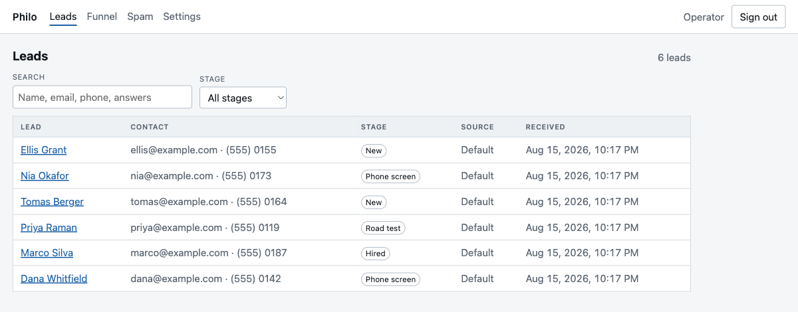
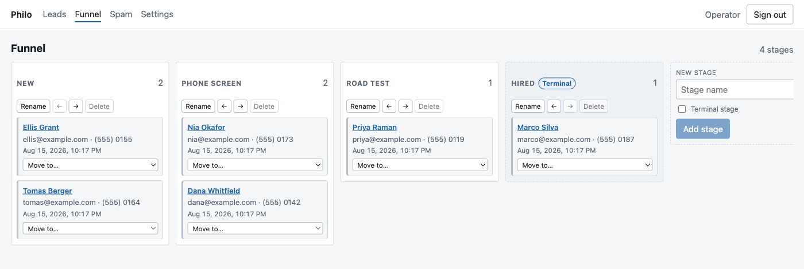
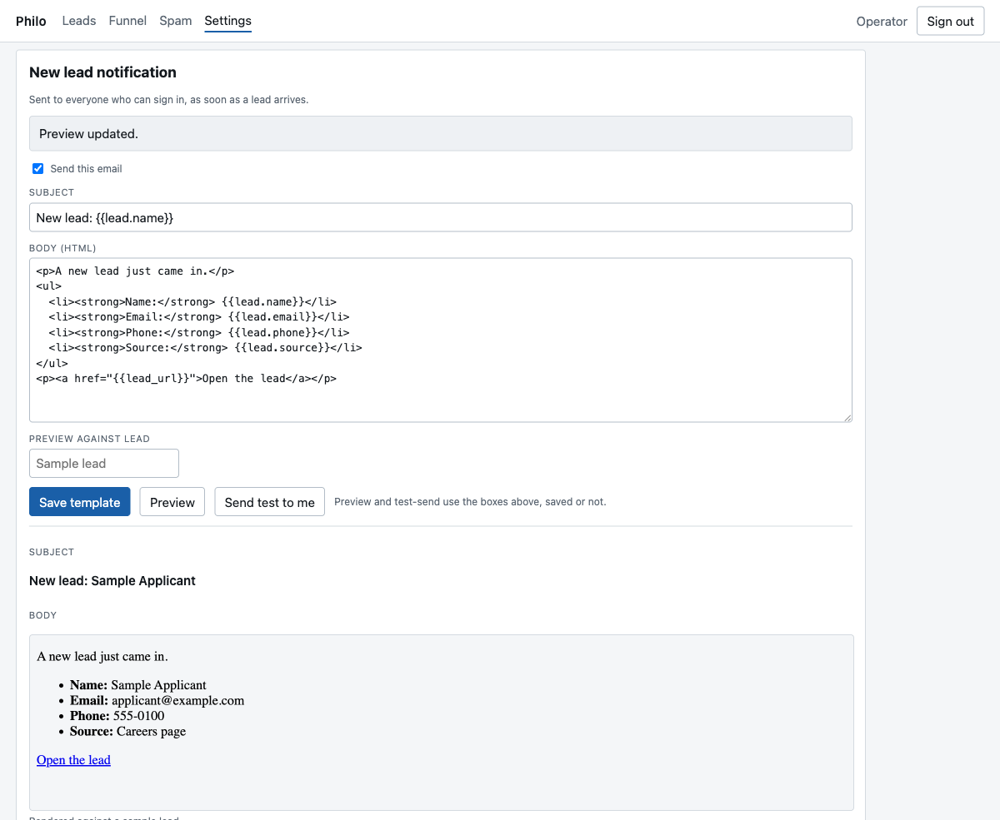
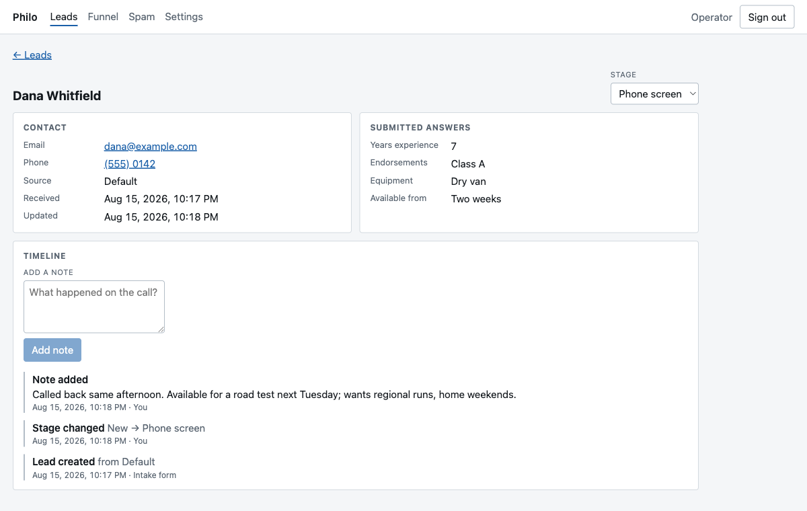

# Philo

A self-hosted, open-source **CRM** for small businesses.

Philo captures leads from your website, moves them through a funnel you define,
and notifies you the moment a new one arrives — push to your phone, email to
your inbox, and an acknowledgment to the person who applied or inquired.

**Deployment model: one instance per business.** Philo is deliberately
single-tenant. There is no organizations table, no tenant isolation, no plan
tiers — and there never will be. That simplicity is the product.



## Quick start

```bash
docker run -d --name philo --restart unless-stopped \
  -p 127.0.0.1:3000:3000 \
  -v philo-data:/data \
  -e PHILO_PUBLIC_BASE_URL=https://philo.example.com \
  -e PHILO_TRUSTED_PROXY=true \
  ghcr.io/philo-crm/philo:latest
```

Point a reverse proxy with TLS at `127.0.0.1:3000`, open your base URL, and sign
in — the first time, the sign-in dialog creates the operator account instead. Then `docker logs philo` — the boot log
prints the intake URL your website's form should POST to.

Do that first sign-in **promptly**. It is reachable without credentials and closes
for good at the first success, so between the instance becoming publicly
reachable and you filling that form in, whoever gets there first becomes the
admin. On an instance with no data in it the fix is cheap — delete the volume
and start over — but it is easier not to need it.

Serve it over **https**. Browsers refuse push notifications outside a secure
context, and every request carries a bearer token that should not cross a
network in the clear.

> **Tags:** `:latest` tracks the newest release, and each one also publishes
> `:X.Y.Z`, `:X.Y`, and `:X` — pin to whichever you want to hold still.
> `:edge`, built from every push to `main`, runs ahead of the releases.

Full walkthrough, including reverse-proxy examples and backups:
**[docs/DEPLOYMENT.md](docs/DEPLOYMENT.md)**. Mail setup:
**[docs/EMAIL.md](docs/EMAIL.md)**.

## What it does

**Lead intake.** A form on your existing website POSTs to
`/api/intake/{form_key}`. It takes JSON or a plain urlencoded form, so an HTML
form with no JavaScript works. Known field names map to columns; everything else
is kept as submitted, so adding a question to your form can never drop a
submission. A hidden honeypot field and a per-caller rate limit handle bots —
and a bot's submission is quarantined rather than dropped, so nothing vanishes
silently.

**Funnels you define.** Rename, reorder, add and remove stages to match how you
actually work — and run a separate funnel per intake flow, each with its own
stages, intake form, email templates and notification recipients. Every lead carries an append-only timeline: created, moved,
noted, emailed.

**Details and files that grow with the lead.** What the form submitted stays as
it was sent; what you learn afterwards — on a call, from a document — goes in the
lead's details or as an attached file, up to 10 MB each. The timeline records
which details changed but never their values.



**Email that you write.** A notification to you and an acknowledgment to the
submitter, both Handlebars templates edited in the app, with a live preview and
a test-send. Any SMTP provider works. Email is the guaranteed channel — a failed
send is retried, and a restart mid-retry does not lose it.



**Push to your phone.** An installable PWA with Web Push. VAPID keys generate
themselves at first boot, so there is nothing to configure; on iOS the app walks
you through adding it to the Home Screen, which is what Apple requires before
push will work at all.

**Full-text search** over names, contact details, every answer a form
submitted, and every detail added since.



## Agent-usable from day one

MCP is a first-class surface, not a bolt-on. `POST /mcp` speaks streamable HTTP,
with read-and-write tools for leads and the email templates and a read of the
funnel — so an agent can pre-screen an applicant, write up the call, and advance
them to the next stage.

Two ways to authenticate, both bearer tokens:

- **An API key** from Settings, for Claude Code, a script, or a cron job.
- **OAuth 2.1**, for connector clients that will not hold a static key. Philo is
  its own OIDC identity provider — dynamic client registration, PKCE, refresh
  tokens, one sign-in-and-consent page — or defers to one you already run.

There is also a hand-written `GET /llms.txt` — a tour of every machine-facing
surface, written for an agent that has just arrived and has no credential yet.

Underneath both the app and MCP is a conventional REST API at `/api/v1`, and
`@philo/sdk`, the typed client they both use, is there for anything else.

## What it will not do

- **Multi-tenancy.** One business, one instance, forever.

## How it is built

A headless API server that also hosts the identity provider; a TypeScript SDK
that tracks it; and two clients of that SDK — the Vite/React PWA for people and
the MCP server for agents. The container runs all of them in one Node process on
one origin, over one SQLite file. TypeScript and Hono throughout, Drizzle for the
schema, SQLite FTS5 for search. All state — the database and the secrets Philo generates
for itself — lives in one directory, so **backup is copying that directory**.
That includes attached files and anything sensitive you record about a lead, so
protect the directory and its backups the way you would the records themselves.

The reasoning is written down: [docs/DESIGN.md](docs/DESIGN.md) for the
architecture, [docs/adr/](docs/adr/) for the contested calls.

## Documentation

| | |
|---|---|
| [docs/DEPLOYMENT.md](docs/DEPLOYMENT.md) | Running it, HTTPS, environment variables, backup, upgrades |
| [docs/EMAIL.md](docs/EMAIL.md) | SMTP setup, Resend walkthrough, deliverability, templates |
| [docs/DESIGN.md](docs/DESIGN.md) | Product and architecture |
| [docs/adr/](docs/adr/) | Architecture decision records |
| [CONTRIBUTING.md](CONTRIBUTING.md) | Development setup, tests, database changes |
| [AGENTS.md](AGENTS.md) | Guide for AI coding agents working on this repo |
| `GET /llms.txt` | On a running instance: the agent tour of its own API |

## Status

Every MVP feature shipped in `v0.1.0`: intake, leads and funnel, the PWA,
push, email, API keys, MCP, and the OAuth server. `v0.2.0` makes the server
headless, with `@philo/sdk` as the client the PWA and MCP use, and `v0.3.0`
lets MCP clients create, update, reorder and delete pipeline stages. Run the latest
release unless you want `main`, which `:edge` tracks.

## Naming

| Thing | Value |
|---|---|
| Product name | Philo |
| Binary / package | `philo` |
| Docker image | `ghcr.io/philo-crm/philo` |
| Env var prefix | `PHILO_` |
| Database name | `philo` |
| Config dir | `~/.config/philo/` |

## Contributing

See [CONTRIBUTING.md](CONTRIBUTING.md). Philo is a sibling project of
[ollie](https://github.com/olliefms/ollie) and follows the same conventions:
DCO sign-off, conventional commits, trunk-based releases.

## License

[AGPL-3.0](LICENSE)
